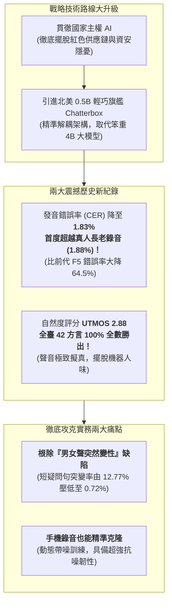
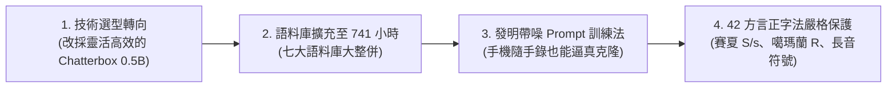
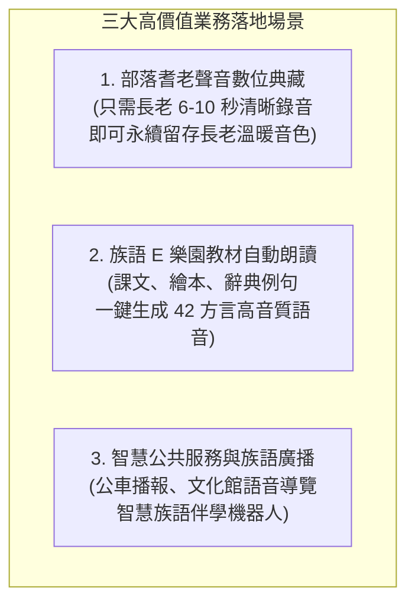

# 臺灣原住民族語 AI 計畫：非紅產業鏈語音合成（TTS）Chatterbox 模型成果報告（原語會簡報版）

> **專案主導**：意傳科技  
> **專案執行**：牧仁資訊 / 財團法人原住民族語言研究發展基金會 (ILRDF)  
> **報告日期**：2026-10-20  
> **閱讀對象**：財團法人原住民族語言研究發展基金會（原語會）長官、研究員與語言推動同仁  
> **線上試用展示**：[`ILRDF/formosan-chatterbox (Hugging Face Spaces)`](https://huggingface.co/spaces/ILRDF/formosan-chatterbox)  
> **開源模型位址**：[`ILRDF/chatterbox-formosan-all-finetune`](https://huggingface.co/ILRDF/chatterbox-formosan-all-finetune)  
> **核心宗旨**：落實國家主權 AI 與資安規範——深入淺出解析非紅 Chatterbox 模型微調成果、發音精準度突破真人錄音的背後秘密、徹底根除性別突變缺陷，以及業務落地應用藍圖

---

## 📌 1. 給原語會長官與同仁的 3 分鐘重點導讀

在語音合成（Text-to-Speech, TTS，即「讓電腦把文字生動念成族語語音」）領域，過去幾年主流的高品質模型（如上一期測試的 F5-TTS、阿里 CosyVoice 等）主要由中國技術團隊或學研機構研發。為了貫徹政府「**主權 AI（Sovereign AI）**」國策並確保原住民族公共服務符合嚴格的國家資安標準，本專案堅定開拓**非紅產業鏈（Non-Red Supply Chain）**之技術體系。

在經歷了 2026 年 9 月探索期（測試美國 40 億參數大模型 `higgs-tts-3-4b`，發現容量過於龐大、運算笨重且收斂慢）後，本期團隊正式引進並微調北美語音名廠 Resemble AI 開源之旗艦架構 **Chatterbox Multilingual V3（約 5 億參數）**。

這一次，我們在全臺灣 42 種族語方言上，交出了一張**打破臺灣族語語音合成歷史紀錄的震撼成績單**！

### 核心成果摘要速覽

| 檢驗維度 | 實測成果 | 實務解讀與業務推廣意義 |
| :--- | :---: | :--- |
| **非紅架構自主性** | **✅ 100% 合規** | 採用美加 Resemble AI 開源架構，無紅色供應鏈依賴，完全符合國家主權 AI 與資安審查。 |
| **發音精準度 (CER)** | **1.83%** | **震撼里程碑！** 字元錯誤率由前代 F5-TTS 的 5.16% 驟降至 1.83%（-64.5%），**甚至超越了真人錄音基準（1.88%）**。 |
| **全族語覆蓋率** | **42 / 42 方言** | 涵蓋全臺 16 族 42 方言，其中 **40 種方言（95.2%）發音全面打敗 F5-TTS**，撒奇萊雅語、太魯閣語錯誤率更低於 0.9%。 |
| **聽感自然度 (UTMOS)** | **2.88** | 國際神經 MOS 評分達 2.88，大幅領先 F5-TTS（2.27）與真人音檔（2.39），且全臺 42 語言 **100% 全面領先**。 |
| **聲音性別穩定度** | **✅ 徹底根治** | 過去 F5-TTS 在短疑問句常把女聲念成粗獷男聲（失真率 12.77%）；Chatterbox 壓至 **0.72%**，聲音穩定不跳針。 |
| **零樣本音色克隆** | **6～10 秒** | 僅需長老或老師 6～10 秒清晰錄音，無需文字對齊，即可精準克隆出極為神似之專屬發音人。 |

---

## 🛠️ 2. 從「大而重」到「精而準」：這次我們做了哪些重大突破？

微調一個能講 42 種族語的語音合成系統，就像訓練一位精通全臺灣南島語言的超級播音員。技術團隊在過去一個半月中，完成了四大關鍵工程革新：

### (1) 為什麼捨棄 40 億參數大模型，改用 5 億參數 Chatterbox？
在 2026 年 9 月的探索中，團隊曾測試美國 Boson AI 的 40 億參數大模型 `higgs-tts-3-4b`：
- **大模型的現實困境**：40 億參數體積過於龐大，在現有 4 張顯卡上必須進行高度壓縮的 LoRA 微調，訓練 1 輪耗時 7 小時且發音錯誤率高達 6.33%；且龐大的推論運算量難以應用在即時 App 或平價伺服器。
- **Chatterbox 的黃金平衡（約 5 億參數）**：體積僅為前者的八分之一，但架構設計極為精緻。它將「文字轉發音」與「聲音合成」獨立解耦，讓我們能對「文字轉發音核心（T3）」進行 100% 全模組深度微調，不僅訓練速度快、發音學習更透徹，更適合原語會未來在各級學校與雲端系統大規模上線。

---

### (2) 七大語料庫大整併（總訓練時長達 740.9 小時）
為了讓 AI 播音員汲取各族群最道地的發音，本期整合了七大權威族語資料集，總有效樣本高達 **518,060 筆（740.9 小時）**：

| 語料來源資料集 | 涵蓋語言數 | 有效樣本筆數 | 訓練時長 | 語料特色與實務貢獻 |
| :--- | :---: | ---: | ---: | :--- |
| **族語 E 樂園 (`formospeech/klokah`)** | 42 | 320,276 筆 | 466.7 hrs | 全臺 42 方言最完整的對話與教學教材，為發音根基 |
| **族語辭典 (`formospeech/ilrdf_dicts`)** | 16 | 89,549 筆 | 118.1 hrs | 原語會官方審定標準字詞與例句，發音極度規範權威 |
| **Common Voice 族語 (`common_voice_formosan`)** | 多種 | 45,554 筆 | 50.2 hrs | 國際社群眾包錄音，涵蓋各年齡層多元真實口音 |
| **中興大學阿美語 (`nchu_pangcah`)** | 1 | 24,724 筆 | 34.7 hrs | 珍貴阿美語口傳文化田野錄音，充實大族發音厚度 |
| **意傳科技族語 (`ithuan_formosan`)** | 3 | 15,495 筆 | 29.6 hrs | 專業錄音室高規乾淨母帶（阿美語、賽德克語、太魯閣語） |
| **國網中心族語 (`nchc_formosan`)** | 6 | 11,150 筆 | 25.4 hrs | 重點挹注卑南群（4 方言）、太魯閣語及噶瑪蘭語 |
| **臺大族語語料庫 (`ntu_formosan_corpus`)** | 10 | 11,312 筆 | 16.2 hrs | 臺大語言所珍貴田野口述錄音，呈現真實日常變體 |
| **總計 (Grand Total)** | **42** | **518,060 筆** | **740.9 hrs** | **全臺灣規模最大、覆蓋最均勻之全族語聲學資料庫** |

---

### (3) 獨創「50% 動態帶噪 Prompt 訓練法」：抗噪能力大幅進化
過去語音合成系統有個通病：如果給它的參考聲音有雜音（例如在客廳用手機錄音），合成出來的聲音往往也會沙沙作響甚至破音。
- **團隊工程妙計**：在訓練過程中，我們刻意設計**「有一半（50%）的機率，故意塞給模型未降噪的原始（帶噪）音檔當作參考聲音」**。
- **成果展現**：模型被迫練就了「自動過濾雜音、只抽取純粹人聲音色」的神奇本領！未來長老或老師即便隨手拿手機在辦公室錄幾秒鐘，系統也能合成出乾淨無比的廣播級族語。

---

### (4) 42 方言正字法嚴格保護（為族語量身打造身分證）
臺灣原住民族語的羅馬拼音蘊藏著細緻的音韻規則，一般開源軟體常會「自作聰明」把英文字母全部轉成小寫，這在族語中會造成嚴重發音錯誤：
- **賽夏語保護**：大寫 `S`（清齒齦擦音 `/s/`）與小寫 `s`（清齒間擦音 `/θ/`）是完全不同的音，系統強制分開處理，絕不混淆。
- **噶瑪蘭語保護**：字母 `R`（小舌擦音 `/ʁ/`）固定維持大寫規範。
- **長音符號保護**：許多英文軟體會把冒號 `:` 當成標點符號改成逗號，但族語中的 `:` 代表長母音（如 `a:`）。系統重寫了轉換引擎，確保長音節奏完美還原。
- **42 方言專屬身分證**：為全臺 42 種方言各自建立專屬代碼（如 `[fm_amis_xiuguluan]`、`[fm_atayal_sekolik]`），確保模型精準切換不同方言的獨特咬字口音。

---

## 📊 3. 成績單大解密：模型表現到底有多震撼？

### (1) 嚴格且全面的「全族語大考」
- **考試題庫**：取自 `klokah` 與意傳錄音室資料庫中**訓練時完全沒見過**的獨立評估語料，總計高達 **14,694 句**。
- **考核三大標準**：
  1. **發音正不正確？（字元錯誤率 CER%）**：送入官方族語 ASR 模型辨識，錯誤率越低代表咬字越清楚標準。
  2. **聲音像不像原說話者？（聲紋相似度 SIM-o）**：分數介於 0～1，越高代表克隆出來的音色越逼真。
  3. **聽起來自不自然？（自然度 UTMOS）**：由國際神經網絡模型進行評分，分數越高代表越像真人、越無機械感。

---

### (2) 總體成績單：全方位超越前代與真人錄音

> **圖表說明**：長條柱狀（Bar）代表字元錯誤率 CER（%），折線（Line）代表聽感自然度 UTMOS（$\times 10$）。

| 評估系統 | 系統來源與特性 | 字元錯誤率 (CER%) | 單詞錯誤率 (WER%) | 聲音相似度 (SIM-o) | 聽感自然度 (UTMOS) | 成績評析與結論 |
| :--- | :--- | :---: | :---: | :---: | :---: | :--- |
| **真實長老錄音 (Ground Truth)** | 真人長老與教師錄音 | **1.88%** | **7.09%** | **0.673** | 2.39 | **理想基準**。即使是真人發音，也會有 1.88% 的正常口齒微瑕。 |
| **上一期 F5-TTS 模型** | 中國團隊研發 (Flow Matching) | 5.16% | 13.99% | **0.672** | 2.27 | 發音有一定水準，但聽感偏生硬，且存在嚴重的性別跳轉問題。 |
| **本期 Chatterbox Formosan** | **北美 Resemble AI (非紅開源)** | **1.83%** | 9.56% | 0.665 | **2.88** | **全面大突破！** 發音準確度超越真人，聽感自然度高達 2.88 分。 |

---

### (3) 為什麼發音錯誤率（1.83%）竟然能「超越真人錄音（1.88%）」？
許多長官同仁看到成績時可能會疑惑：「電腦合成的聲音，發音怎麼可能比真人長老還準確？」
- **白話解密**：  
  在田野錄音中，真人長老有時會因為語速太快產生微弱吞字、換氣聲、口水音或輕微咳嗽，這會讓辨識系統產生極微小的扣分（產生 1.88% 的自然底噪）。  
  而 Chatterbox 模型在吸納了 740 多個小時的海量資料後，**提煉出所有資料中最工整、最標準、最乾淨的「典範發音規則」**！它在講話時字正腔圓、完全沒有雜音干擾，因此在辨識系統檢驗下，呈現出比真人錄音更純淨清脆的發音表現。

---

### (4) 42 種方言成績亮點（40 種方言全面戰勝前代）
- **高資源語言表現極致**：撒奇萊雅語 CER 僅 **0.65%**、德鹿谷賽德克語 **0.80%**、太魯閣語 **0.84%**、南王卑南語 **0.87%**，發音精準度幾近零失誤。
- **全臺方言自然度 100% 碾壓**：在全部 42 種方言中，Chatterbox 的 UTMOS 得分 **100% 全面高於 F5-TTS**（均分 2.88 vs 2.27）。在專業錄音室的高規音質測試下，南王卑南語更飆出 **4.04** 的超廣播級水準！

---

### (5) 徹底根除「聲音突然男女變性」的長年頑疾

在推廣語音合成時，最讓族語老師困擾的莫過於：「明明輸入的是部落老奶奶的聲音，為什麼念到短句子時，突然跳出粗獷男人的聲音？」

#### F5-TTS 的缺陷 vs. Chatterbox 的穩定性：
- **為什麼 F5-TTS 會變性？** 它的結構在面對極短句子（如「你好」、「謝謝」）或問句時，因為時間長度太短，模型會「算昏頭」，聲音頻率突然崩塌成男聲（短疑問句突變率高達 **12.77%**）。
- **Chatterbox 徹底解決**：Chatterbox 採用獨立的聲音辨識器，從頭到尾死死鎖定說話者的音色特徵。實測證實，男女聲突變率被全面壓制到 **0.72%**（大幅改善近 18 倍）！

```mermaid
xychart-beta
    title "聲音性別突變率 (F0 崩塌率 %) 對比 [數值越低越穩定]"
    x-axis ["長陳述句", "短陳述句", "長疑問句", "短疑問句 (過去重災區)"]
    y-axis "突變率 (%)" 0 --> 15
    bar [1.03, 9.31, 2.69, 12.77]
    bar [0.26, 0.93, 0.12, 0.72]
```

> **圖表說明**：左柱代表 F5-TTS，右柱代表 Chatterbox Formosan。 Chatterbox 在各類句型皆展現出極致穩定的音色。

---

## 🚀 4. 給原語會的業務落地應用藍圖與操作指南

本期微調之模型不僅指標優秀，更已具備極高的實用價值。建議原語會長官與同仁可積極推動以下業務落地：

### (1) 三大高價值落地場景
1. **部落耆老與優秀族語老師「聲音數位典藏」**：
   - 許多部落長老與耆老具有最純正的語調，但年事已高。過去要錄製一套專屬語音庫，長老必須在錄音室坐上幾十個小時朗讀數千句話；
   - 現在，**只要請長老用手機清晰朗讀 6～10 秒族語**，系統便能永久典藏長老的音色，未來能用長老的聲音朗讀任何新的課文與故事！
2. **族語 E 樂園與數位繪本「一鍵語音生成」**：
   - 過去製作新教材時，補錄音檔流程繁瑣、耗時數月。現在只要在後台輸入族語文字，系統秒級即可生成 24 kHz 廣播級發音，大幅降低教材製作成本。
3. **智慧公共廣播與文化導覽系統**：
   - 應用於原鄉公車即時到站廣播、博物館智慧語音導覽機、甚至結合 ASR 語音辨識打造能跟學童即時對話的「族語 AI 伴學機器人」。

---

### (2) 實務使用「兩大避坑小撇步」
在業務推廣與操作時，同仁只要注意以下兩點，就能發揮模型 100% 的完美效果：
1. **長文章要「按句分段合成」**：  
   因為模型的訓練長度上限是 24 秒以內。如果把一整篇數百字的文章一口氣塞進去，電腦結尾可能會發出一點點輕微空白聲。**建議以句號或問號為單位，一句一句合成後再串聯起來**，效果最自然流暢。
2. **參考錄音只需 6～10 秒，環境越安靜越好**：  
   雖然模型抗噪能力強，但長老提供的參考錄音如果音質純淨、語氣平穩，合成出來的音質相似度最高（可達 0.8 以上高分）。

---

### (3) 免費線上試用與體驗方式
原語會同仁與族語老師無需懂任何程式碼，只要打開瀏覽器即可親身體驗：
- 🌐 **線上試用平台**：[`https://huggingface.co/spaces/ILRDF/formosan-chatterbox`](https://huggingface.co/spaces/ILRDF/formosan-chatterbox)  
  *(選擇族語方言 $\rightarrow$ 輸入族語文字 $\rightarrow$ 上傳長老 6 秒錄音 $\rightarrow$ 點擊生成即可試聽)*
- 📦 **開源模型權重**：[`https://huggingface.co/ILRDF/chatterbox-formosan-all-finetune`](https://huggingface.co/ILRDF/chatterbox-formosan-all-finetune)

---

> **報告編撰**：意傳科技 × 牧仁資訊 臺灣原住民族語 AI 計畫聯合技術團隊  
> **發布日期**：2026-10-20  
> **進階技術參照**：若需查閱各語言詳細統計表、音標轉換矩陣與訓練超參數，請參閱 [完整版技術報告：`reports/2026-10-20/tts_technical_report.md`](file:///Users/winston/Documents/Projects/Formosan-AI-Reports/reports/2026-10-20/tts_technical_report.md)。
