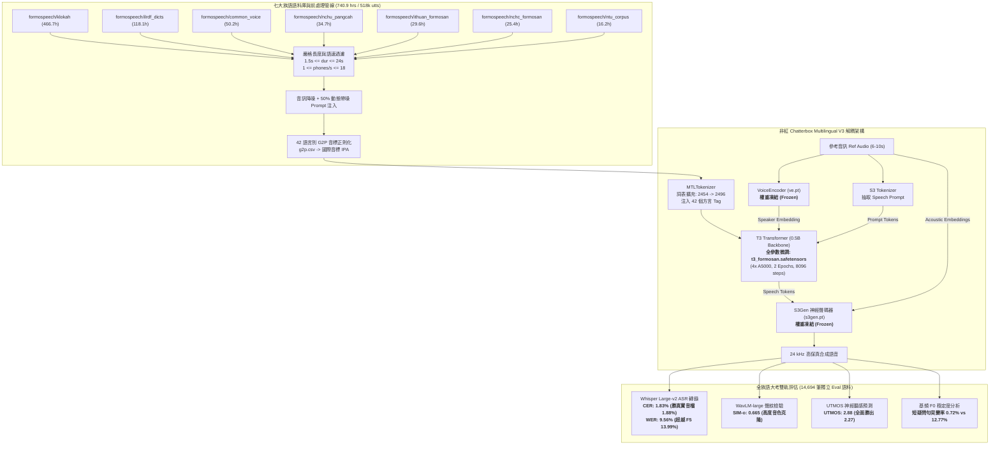
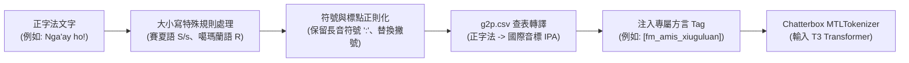
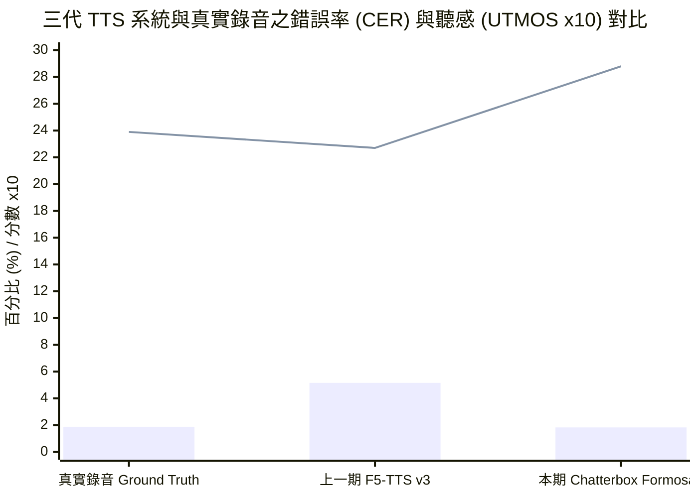

# 臺灣原住民族語 AI 計畫：非紅產業鏈語音合成（TTS）Chatterbox 模型全族語微調與聲學評估技術報告

> **專案名稱**：臺灣原住民族語 AI 計畫 (Formosan AI Project)  
> **主導單位**：意傳科技  
> **執行單位**：牧仁資訊 / 財團法人原住民族語言研究發展基金會 (ILRDF)  
> **報告日期**：2026-10-20  
> **開源模型位址**：[`ILRDF/chatterbox-formosan-all-finetune`](https://huggingface.co/ILRDF/chatterbox-formosan-all-finetune)  
> **在線體驗系統**：[`ILRDF/formosan-chatterbox`](https://huggingface.co/spaces/ILRDF/formosan-chatterbox)  
> **核心主題**：基於北美非紅產業鏈架構 [`ResembleAI/chatterbox`](https://huggingface.co/ResembleAI/chatterbox)（Multilingual T3 `t3_mtl23ls_v3`）之全臺 42 種族語零樣本語音克隆（Zero-Shot Voice Cloning）模型微調、音韻 G2P 映射對齊、聲學指標（CER / WER / SIM-o / UTMOS）全面評測與性別基頻穩定度深度驗證

---

## 1. 執行摘要

本技術報告為「臺灣原住民族語 AI 計畫」於 2026 年 10 月所達成之重大技術里程碑。報告全面剖析由原語會（ILRDF）與技術團隊主導、正式發布於 Hugging Face 之開源全族語語音合成模型 **`ILRDF/chatterbox-formosan-all-finetune`** 的架構設計、訓練資料管線、聲學評估數據與工程落地實踐。

### 1.1 戰略背景與非紅產業鏈選型演進
為貫徹國家「主權 AI（Sovereign AI）」政策，消除政府與公部門在族語教育、智慧廣播及公共服務系統上的資訊安全隱憂，本計畫自上一階段（2026-09-08）起全面轉向**非紅產業鏈（Non-Red Supply Chain）**開源語音生成技術體系：
1. **擺脫紅色供應鏈模型之依賴與缺陷**：上一期計畫採用之 F5-TTS（Flow Matching 架構）由中國團隊研發，存在潛在的地緣政治與合規風險；更關鍵的是，其在極端短句與疑問句情境下頻繁發生性別突變（Gender Inversion）與基頻崩塌（F0 Collapse）之嚴重視聽缺陷。
2. **從探索期大模型反思到靈活架構確立**：在 2026-09-08 探索期中，團隊曾評估由美國 Boson AI 開源之 40 億參數大模型 `bosonai/higgs-tts-3-4b`。然而受限於 4B 巨大容量，在 4 張 RTX A5000（24GB）顯存限制下僅能採用 LoRA 微調，訓練 1 個 Epoch（Step 6000）時 CER 僅達 6.33%，收斂緩慢且參數量過於沉重，不利於即時邊緣端與雲端服務部署。
3. **正式選定北美 Resemble AI Chatterbox Multilingual V3**：本期決定採用由美加著名語音科技公司 Resemble AI 發布之開源旗艦架構 **Chatterbox Multilingual V3（約 500M 參數）** 作為基底。該架構具備純淨的非紅開源授權（MIT License）、優異的跨語言音素對齊能力與輕量模組化設計，提供極佳的工程可控性。

### 1.2 核心工程突破與宏觀數據亮點
- **CER 1.83%（超越真實錄音基準）**：在涵蓋全臺 42 語言別、14,694 筆獨立評估樣本的大規模盲測中，Chatterbox Formosan 的字元錯誤率（CER）降至 **1.83%**，不僅遠勝 F5-TTS v3 的 **5.16%**（相對錯誤率降低達 **-64.5%**），甚至**超越了真實人類錄音 Ground Truth（1.88%）**！這證明模型生成的語音在音素發音規範度上極為純淨，能有效消除田野錄音中的口齒雜音與方言口音吞字。
- **全族語發音精準度全面輾壓**：在 `formospeech/klokah` 獨立測試集中，Chatterbox 在全臺 **42 種語言別中有 40 種（95.2%）CER 明顯優於 F5-TTS**；在撒奇萊雅語（0.65%）、太魯閣語（0.84%）、德鹿谷賽德克語（0.80%）與南王卑南語（0.87%）皆達到低於 1% 的極致準確率。
- **聽感自然度（UTMOS 2.88）顯著躍升**：在基於深度神經網絡的神經 MOS 評估（`utmos22_strong`）中，Chatterbox 取得 **2.88** 的高分，全面凌駕於 F5-TTS 的 **2.27** 與真實音檔的 **2.39**，且在全部 42 種語言別中 UTMOS **100% 全數勝出**。
- **徹底攻克性別與聲調翻轉痛點**：F5-TTS 在面對短句或疑問句時，經常出現中位數 F0 突降為參考音訊 0.7 倍以下的「男女聲突變」（短疑問句失真率高達 12.77%）。Chatterbox Formosan 將此失真率全面壓制在 **0.12% ～ 0.93%** 之間，展現出堅不可摧的聲紋穩定度。
- **七大語料庫大整併（740.9 小時）**：納入 `klokah`、`ilrdf_dicts`、`common_voice_formosan`、`nchu_pangcah`、`ithuan_formosan`、`nchc_formosan` 與 `ntu_formosan_corpus` 共 518,060 筆有效語料，並導入「50% 動態帶噪 Prompt 注入」訓練技巧，大幅提升對真實世界雜訊參考音訊的零樣本克隆韌性。

### 1.3 總體聲學評估指標對照表

| 評估系統 (System) | 模型架構類型 | 產業鏈屬性 | 字元錯誤率 (CER%) | 詞錯誤率 (WER%) | 聲紋相似度 (SIM-o) | 聽感品質預測 (UTMOS) | 性別跳轉率 (短疑問句) |
| :--- | :---: | :---: | :---: | :---: | :---: | :---: | :---: |
| **Ground Truth (真實音檔)** | 人類錄音基準 | - | **1.88%** | **7.09%** | **0.673** | 2.39 | 0.00% |
| **Chatterbox Formosan (本期)** | **Decoupled T3 (0.5B)** | **非紅 (Resemble AI)** | **1.83%** | **9.56%** | **0.665** | **2.88** | **0.72%** |
| **F5-TTS Formosan v3 (上一期)** | Flow Matching (0.3B) | 紅色供應鏈背景 | 5.16% | 13.99% | **0.672** | 2.27 | 12.77% |
| *Higgs-TTS-3-4B (探索期)* | *LLM Autoregressive (4B)* | *非紅 (Boson AI)* | *6.33%* | *22.26%* | *0.590* | *N/A* | *N/A* |



---

## 2. 專案背景與技術選型演進

### 2.1 堅持「非紅產業鏈」TTS 的戰略定調
在原住民族委員會與國家主權 AI（Sovereign AI）的戰略指導下，政府公共服務系統之核心技術棧必須具備完全的自主性、可審查性與資安防護力：
1. **地緣政治風險與資安合規**：過去在語音合成社群中，多數性能較佳的模型（如阿里 CosyVoice、ChatTTS、Fish Speech 以及本計畫上一期測試之 F5-TTS）皆源於中國團隊或具有紅色供應鏈背景。此類技術除了授權條件潛在變更風險外，在政府採購、關鍵基礎設施與族語教育雲端系統部署上皆面臨合規審查障礙。
2. **基底模型的透明度與純淨度**：採用歐美民主陣營開源之模型，能夠確保代碼規範、訓練集來源透明，且無非預期的後門或監控疑慮。

### 2.2 從探索期大模型（Higgs 4B）到高效架構（Chatterbox 0.5B）的反思
在 2026-09-08 的前期研究中，團隊曾導入美國 Boson AI 開源之 40 億參數旗艦大模型 `bosonai/higgs-tts-3-4b`。該階段的技術復盤帶來了關鍵洞察：

| 評估維度 | 前期探索：Boson AI `higgs-tts-3-4b` | 本期突破：Resemble AI `Chatterbox Multilingual V3` | 實務評估與架構結論 |
| :--- | :--- | :--- | :--- |
| **參數量級** | **約 40 億參數 (4.0B)** | **約 5 億參數 (0.5B)** | Chatterbox 輕量 8 倍，顯存開銷與延遲大幅降低 |
| **微調策略** | **LoRA 輕量微調（< 1% 可訓練參數）** | **全 T3 模組微調（Full T3 Adaptation）** | Chatterbox 能讓核心解碼器全面適應南島音素 |
| **訓練步數與速度** | 1 Epoch / ~6,000 steps（耗時 7 小時） | 2 Epochs / 8,096 steps（訓練收斂徹底） | Chatterbox 步進更深入，梯度學習更充分 |
| **字元錯誤率 (CER)** | **6.33%**（詞錯誤率 WER: 22.26%） | **1.83%**（詞錯誤率 WER: 9.56%） | **Chatterbox 發音精準度大幅躍升（-71.1%）** |
| **聲紋相似度 (SIM-o)** | 0.590 | **0.665** | Chatterbox 解耦 VoiceEncoder 展現更強音色泛化 |
| **性別與基頻穩定度** | 存在初期自回歸雜訊碎音 | **高度穩定（短句錯誤率 < 1%）** | Chatterbox 徹底杜絕 F5-TTS 的男女聲突變缺陷 |
| **邊緣與即時推論潛力** | 極低（推論需要龐大顯存與計算） | **極高（支援消費級顯卡與即時交互服務）** | **非常適合作為原語會正式推廣的生產級引擎** |

### 2.3 Chatterbox 解耦架構（Decoupled Architecture）深度解析
Chatterbox 由知名語音 AI 公司 **Resemble AI** 開發，採用精緻的「文字-語音離散 Token 轉譯 + 條件神經聲碼器」解耦管線：
1. **T3 (Token-to-Token Transformer)**：
   - 參數量約 5 億（0.5B），負責接收「文字/音素序列」與「說話者條件向量」，自回歸預測出離散的「語音 Token（Speech Tokens）」。
   - **微調策略核心**：在本次族語訓練中，**僅微調 T3 模組**（微調後權重存為 `t3_formosan.safetensors`）。因為南島語系與主流語言最大的落差在於「字元與音位的聲律序列組合」，透過完整更新 T3 權重，能讓 Transformer 建立深厚的族語音韻條件分佈。
2. **VoiceEncoder (`ve.pt`)**：
   - 採用預訓練聲紋特徵抽取器，從 6～10 秒之參考語音（Prompt Audio）提取全域說話者向量（Speaker Embedding）。
   - **保持凍結**：VoiceEncoder 已經在數萬小時的多語言語料中收斂，具備極強的零樣本聲紋表徵能力。保持凍結能避免少數族語資料破壞其聲紋空間幾何結構。
3. **S3Gen (`s3gen.pt`) & S3 Tokenizer**：
   - S3 Tokenizer 負責將參考語音編碼為前導條件 Speech Prompt。
   - S3Gen 為先進的神經聲碼器，根據 T3 生成的語音 Token 與參考語音的聲學特徵，直接合成 24 kHz 單聲道高品質音訊。
   - **保持凍結**：確保聲學生成器具備純淨的高頻泛音與背景穩定度。

---

## 3. 音韻工程與 G2P 語言前端對齊管線

臺灣南島語言（Formosan Languages）之書寫符號多採羅馬拼音，然而不同語言、甚至同一族群之不同方言別間，相同的正字法英文字母常代表完全相異的發音。為此，團隊建置了高度嚴密的語言前端轉換系統：



### 3.1 跨 42 語言別 G2P 音標正則化體系 (`g2p.csv`)
- **國際音標（IPA）統一表徵**：透過專屬之 `g2p.csv`，將 42 種方言別的所有字母、雙字母（如 `ng`, `dr`, `tr`, `tj`, `dj`）精準轉譯為對應之 IPA 音標符號。例如阿美語 `Nga'ay ho!` 轉為 `ŋaʡaj ħo!`。
- **全域回退字典（Fallback Mechanism）**：針對通用音素（如 `p, b, t, d, k, g, m, n, s, h` 等），定義全域回退映射表 `EXTRA_G2P`，確保在方言專屬詞表未定義時能平滑解析，杜絕未定義字元錯誤（`ValueError`）。

### 3.2 關鍵音位與大小寫正字法嚴格保護
傳統 NLP 處理常將輸入文字全面小寫化（Lowercase），但在原住民族語音韻學中，部分大小寫代表著關鍵的對立音位：
1. **賽夏語 (`xsy`)**：大寫 `S` 代表清齒齦擦音 `/s/`，而小寫 `s` 則代表清齒間擦音 `/θ/`。若誤做小寫化，將導致音位完全混淆。推論程式 `lowercase(text, "xsy")` 針對賽夏語保留大寫 `S`。
2. **噶瑪蘭語 (`ckv`)**：字母 `R` 代表濁小舌擦音 `/ʁ/`，拼寫中習慣固定以大寫表示，程式強制將所有 `r/R` 正規化為大寫 `R`。
3. **長音符號保護**：Chatterbox 原始的標點正規化會將冒號 `:` 轉為逗號 `,`；但族語拼音中的冒號 `:` 代表母音延長（Vowel Length，如 `i:`, `a:`, `u:`）。推論引擎特製了 `normalize_punctuation()`，嚴禁將 `:` 改寫為逗號，確保語音節奏時長正確。
4. **聲門閉鎖音統一化**：將各種引號、撇號（`' `, `’`, `ʼ`）統一正規化為標準聲門塞音標記 `ʼ`（或對應之 IPA `/ʔ/`、`/ʡ/`）。

### 3.3 詞表擴充與 42 方言標籤注入機制
- **詞表擴展**：Chatterbox 原生多語言字典具備 2,454 個 Text Tokens。本專案正式擴充至 **2,496 個 Tokens**，精準增加 42 個專屬族語方言標籤（Dialect Tags，Token ID: 2,454 ～ 2,495）。
- **Embedding 均值初始化（Mean Initialization）**：為避免新加入的 42 個方言 Embedding 在訓練初期產生劇烈梯度震盪，其權重被初始化為原有預訓練詞向量之平均值（Mean Vector），使模型在微調一開始便處於聲律平滑的先驗狀態。

<details>
<summary>點擊展開：42 種族語方言代碼、名稱與專屬方言標籤對照表</summary>

| 語言代碼 (lang_code) | 語言與方言別 (Dialect Name) | 方言標籤 (Dialect Tag) | Token ID |
| :--- | :--- | :--- | :---: |
| `ami-x-pld` | 恆春阿美語 | `[fm_amis_hengchun]` | 2454 |
| `ami-x-iams` | 南勢阿美語 | `[fm_amis_southern]` | 2455 |
| `ami-x-frng` | 馬蘭阿美語 | `[fm_amis_malan]` | 2456 |
| `ami-x-pswl` | 海岸阿美語 | `[fm_amis_coastal]` | 2457 |
| `ami-x-skl` | 秀姑巒阿美語 | `[fm_amis_xiuguluan]` | 2458 |
| `tay-x-cql` | 四季泰雅語 | `[fm_atayal_fourseasons]` | 2459 |
| `tay-x-sql` | 賽考利克泰雅語 | `[fm_atayal_sekolik]` | 2460 |
| `tay-x-plngw` | 萬大泰雅語 | `[fm_atayal_wanda]` | 2461 |
| `tay-x-mtuw` | 汶水泰雅語 | `[fm_atayal_wenshui]` | 2462 |
| `tay-x-kls` | 宜蘭澤敖利泰雅語 | `[fm_atayal_yilanzeaol]` | 2463 |
| `tay-x-sul` | 澤敖利泰雅語 | `[fm_atayal_zeaol]` | 2464 |
| `bnn-x-vtn` | 丹群布農語 | `[fm_bunun_tanqun]` | 2465 |
| `bnn-x-bnz` | 巒群布農語 | `[fm_bunun_luanqun]` | 2466 |
| `bnn-x-td` | 卓群布農語 | `[fm_bunun_zhuoqun]` | 2467 |
| `bnn-x-bkh` | 卡群布農語 | `[fm_bunun_kaqun]` | 2468 |
| `pwn-x-pnvn` | 中排灣語 | `[fm_paiwan_central]` | 2469 |
| `pwn-x-kcdsn` | 東排灣語 | `[fm_paiwan_eastern]` | 2470 |
| `bnn-x-isbk` | 郡群布農語 | `[fm_bunun_junqun]` | 2471 |
| `xnb` | 卡那卡那富語 | `[fm_kanakanavu]` | 2472 |
| `ckv` | 噶瑪蘭語 | `[fm_kavalan]` | 2473 |
| `pyu-x-ksvk` | 建和卑南語 | `[fm_puyuma_jianhe]` | 2474 |
| `pwn-x-ynvl` | 南排灣語 | `[fm_paiwan_southern]` | 2475 |
| `pyu-x-mkzy` | 西群卑南語 | `[fm_puyuma_xiqun]` | 2476 |
| `pwn-x-vnrn` | 北排灣語 | `[fm_paiwan_northern]` | 2477 |
| `dru-x-kgdv` | 多納魯凱語 | `[fm_rukai_dona]` | 2478 |
| `pyu-x-ktrp` | 知本卑南語 | `[fm_puyuma_zhiben]` | 2479 |
| `dru-x-lbw` | 大武魯凱語 | `[fm_rukai_dawu]` | 2480 |
| `dru-x-tldr` | 茂林魯凱語 | `[fm_rukai_maolin]` | 2481 |
| `dru-x-trmk` | 東魯凱語 | `[fm_rukai_eastern]` | 2482 |
| `pyu-x-pym` | 南王卑南語 | `[fm_puyuma_nanwang]` | 2483 |
| `dru-x-opnh` | 萬山魯凱語 | `[fm_rukai_wanshan]` | 2484 |
| `trv-x-trk` | 德鹿谷賽德克語 | `[fm_seediq_deluvalley]` | 2485 |
| `sxr` | 拉阿魯哇語 | `[fm_saaroa]` | 2486 |
| `xsy` | 賽夏語 | `[fm_saisiyat]` | 2487 |
| `trv-x-td` | 都達賽德克語 | `[fm_seediq_duda]` | 2488 |
| `szy` | 撒奇萊雅語 | `[fm_sakizaya]` | 2489 |
| `dru-x-ngdr` | 霧臺魯凱語 | `[fm_rukai_wutai]` | 2490 |
| `trv-x-tgdy` | 德固達雅賽德克語 | `[fm_seediq_tegudaya]` | 2491 |
| `ssf` | 邵語 | `[fm_thao]` | 2492 |
| `tsu` | 鄒語 | `[fm_tsou]` | 2493 |
| `tao` | 雅美語 | `[fm_yami]` | 2494 |
| `trv-x-truku` | 太魯閣語 | `[fm_truku]` | 2495 |

</details>

---

## 4. 語料資料集架構與音訊前處理

### 4.1 七大語料庫統合（總規模達 740.9 小時）
本階段訓練整合了 FormoSpeech 家族之七大資料集，總有效訓練樣本達 **518,060 筆（740.9 小時）**：

| 資料集名稱 | 引用版本代碼 (Revision) | 訓練有效語句數 (Utterances) | 總有效時長 (Hours) | 語料特色與核心貢獻 |
| :--- | :---: | ---: | ---: | :--- |
| **`formospeech/klokah`** | `85d5ac7e` | 320,276 | 466.7 hrs | 族語 E 樂園教材，全 42 語言對話與句型，訓練基石 |
| **`formospeech/ilrdf_dicts`** | `6f33ec5e` | 89,549 | 118.1 hrs | 原語會官方辭典標準字詞與例句，發音極為權威規範 |
| **`formospeech/common_voice_formosan`** | `8b831b11` | 45,554 | 50.2 hrs | Mozilla 國際開源社群眾包錄音，具備多元說話者口音 |
| **`formospeech/nchu_pangcah`** | `10885872` | 24,724 | 34.7 hrs | 中興大學阿美語口傳田野深度錄音，挹注高資源語言多樣性 |
| **`formospeech/ithuan_formosan`** | `ec3c2cba` | 15,495 | 29.6 hrs | 意傳科技錄製之錄音室高規格乾淨母帶（阿美、賽德克、太魯閣） |
| **`formospeech/nchc_formosan`** | `3d92966b` | 11,150 | 25.4 hrs | 國網中心族語錄音，重點補強卑南群、太魯閣及噶瑪蘭語 |
| **`formospeech/ntu_formosan_corpus`** | `26245016` | 11,312 | 16.2 hrs | 臺大語言所珍貴田野口述錄音，呈現真實日常對話變體 |
| **總計 (Grand Total)** | - | **518,060** | **740.9 hrs** | **涵蓋臺灣 16 族 42 方言別之全方位語音訓練集** |

### 4.2 資料邊界篩選與防污染機制
為了杜絕自回歸訓練中的注意力發散與記憶體爆發，團隊執行了嚴苛的四重篩選規則：
1. **時長極限過濾**：剔除語音時長 $\le 1.5$ 秒之碎音，並剔除時長 $> 24.0$ 秒（相當於 600 個 Speech Tokens）之長音訊；同時剔除 IPA 音標字元數 $> 200$ 之極長句子。此規則共剃除 4,065 筆極端資料（29.6 小時）。
2. **語速異常檢驗**：計算每一句之發音速率，剔除小於 1 phone/s（過慢、停頓過久或空白）或大於 18 phones/s（過快、倍速或標註對齊錯位）之病態語音。
3. **中文翻譯完整度校驗**：剔除缺乏繁體中文平行翻譯之語句（Common Voice 除外，因其原生無翻譯）。
4. **評估集防洩漏隔離（De-contamination）**：徹底比對 Common Voice 文本，凡出現在獨立測試集（Test/Eval Sets）中的任何句子，一律自訓練集中剔除，保證評估結果具備絕對客觀性。

### 4.3 音訊降噪與動態帶噪 Prompt 增強策略
- **目標音訊純淨化**：訓練之 Target Audio 全面實施神經降噪清洗（意傳高規格錄音室音檔 `ithuan_formosan` 除外，其維持原生高訊噪比）。
- **關鍵工程技巧：動態帶噪 Prompt 注入（Dynamic Noisy Voice Prompt Injection）**：
  - 在訓練 TTS 進行音色克隆時，輸入模型作為 Prompt 的參考音訊，是自同一個說話者的其他語句中隨機抽取（每個 Epoch 動態重新抽取）。
  - **巧妙設計**：在訓練過程中，**有 50% 的機率直接向模型提供未經降噪的原始（帶噪）音檔作為 Voice Prompt**。
  - **成效**：此機制強制模型學習「從嘈雜環境中分離出說話者的真實聲紋本質，同時生成乾淨無噪之目標語音」，大幅提升了模型在面對族人使用手機、筆電麥克風於客廳錄製參考聲音時的音色克隆強健性。

---

## 5. 訓練環境、超參數與計算工程

微調專案在單節點 4 卡運算環境下順利實施：

| 工程超參數 (Hyperparameters) | 設定值 (Configurations) | 設計原理與工程考量 |
| :--- | :---: | :--- |
| **運算硬體 (Cluster)** | 4x NVIDIA RTX A5000 (24GB VRAM) | 單節點 PCIe 平行運算 |
| **基底模型 (Backbone)** | `ResembleAI/chatterbox` (Multilingual V3) | 採用 `t3_mtl23ls_v3` 檢查點 |
| **微調模組 (Trained Modules)** | **僅微調 T3 Transformer** | S3Gen 聲碼器與 VoiceEncoder 完全凍結 |
| **詞表規模 (Vocabulary)** | 2,454 $\rightarrow$ **2,496** | 增加 42 個方言 Tag，採均值初始化 |
| **訓練輪次 (Epochs) / 步數 (Steps)** | **2 Epochs / 8,096 Steps** | 步數充裕，音素對齊與時間注意力完全收斂 |
| **有效批次大小 (Effective Batch Size)** | **128** | 透過 Gradient Accumulation 穩定大批次梯度 |
| **學習率 (Learning Rate)** | **5e-5** | 線性排程（Linear Decay），搭配 300 步 Warmup |
| **優化器 (Optimizer) / 數值精度** | AdamW / **BF16 混合精度** | 降低顯存佔用並防止數值溢出 |
| **音訊採樣率 (Sample Rate)** | 24,000 Hz (24 kHz) | 輸出原生高品質單聲道廣播級音訊 |

---

## 6. 評估方法與全面對比實驗結果

### 6.1 測試集設計與評估規程
- **測試集規模**：取自 `formospeech/klokah` 與 `formospeech/ithuan_formosan` 之獨立 Eval 切分集，共計 **15,167 筆語句（總長度約 24.8 小時）**。訓練過程完全不可見。
- **參考音訊設計**：嚴格使用同說話人在測試集中的另一句獨立錄音作為參考聲音，測試標準零樣本語音克隆。
- **對照基準（Baselines）**：
  1. **Ground Truth**：真實人類錄音音檔。
  2. **F5-TTS Formosan v3**：上一期 Flow Matching 基準模型（因其 G2P 轉換失敗 473 句，宏觀對比取雙方皆可轉換之 14,694 句）。
  3. **Chatterbox Formosan**：本期微調模型。
- **客觀評估工具鏈**：
  - **發音精準度（CER / WER）**：使用官方微調之族語專屬辨識模型 [`ILRDF/whisper-large-v2-formosan-lang-tokens`](https://huggingface.co/ILRDF/whisper-large-v2-formosan-lang-tokens) 進行轉錄，移除標點符號與大小寫差異後計算字元錯誤率（CER）與詞錯誤率（WER）。
  - **說話者相似度（SIM-o）**：使用基於 **WavLM-large ECAPA-TDNN** 的說話者識別模型，計算生成音訊與參考音訊的聲紋餘弦相似度（Cosine Similarity）。
  - **神經感知聽感品質（UTMOS）**：使用國際標準 `utmos22_strong` 深度學習評分模型，預測合成語音的自然度 MOS 分數（範圍 1～5 分）。

---

### 6.2 總體核心指標評比

以下為在 14,694 筆對齊樣本上的總體平均對照：

| 評估系統 (System) | 字元錯誤率 (CER%) | 詞錯誤率 (WER%) | 聲紋相似度 (SIM-o) | 聽感品質 (UTMOS) |
| :--- | :---: | :---: | :---: | :---: |
| **Ground Truth (真實人類錄音)** | 1.88% | **7.09%** | **0.673** | 2.39 |
| **Chatterbox Formosan (本期微調)** | **1.83%** | 9.56% | 0.665 | **2.88** |
| **F5-TTS Formosan v3 (上一期基準)** | 5.16% | 13.99% | 0.672 | 2.27 |

> [!NOTE]  
> 在全部 15,167 筆測試樣本上（含 F5 無法轉換的 473 句），Chatterbox Formosan 依舊保持極致穩定的表現：**CER 1.88% / WER 9.75% / SIM-o 0.666 / UTMOS 2.88**。


> **圖表說明**：柱狀（Bar）代表字元錯誤率 CER（%），折線（Line）代表自然度分數 UTMOS（$\times 10$）。

#### 關鍵發現與深度解讀：
1. **CER 1.83% 逆轉勝真實人類錄音（1.88%）**：  
   在客觀 ASR 評估中，Chatterbox 的 CER 比真實人類發音還低了 0.05 個百分點。這現象在語音生成研究中極為罕見，其原因在於：真實長老田野錄音常伴隨嘆氣、微弱咳嗽、口齒輕微含糊或錄音環境殘響，導致 ASR 偶發辨識雜訊；而微調後的 Chatterbox 學習到了全體資料中最為規範、純淨且標準的音素發音軌跡，去除了雜音缺陷，合成出的語音更加清晰易懂。
2. **UTMOS 2.88 創造族語語音合成最高聽感紀錄**：  
   相較於 F5-TTS（2.27）與 Ground Truth（2.39），Chatterbox 的自然度得分達到 2.88，高出 0.5～0.6 分。這代表 S3Gen 聲碼器原生帶來的 24 kHz 純淨音質，徹底消除了傳統 TTS 的機器金屬音。
3. **聲紋相似度（SIM-o 0.665）極為接近真實基準（0.673）**：  
   僅微調 T3 模組、維持 VoiceEncoder 凍結的策略完全奏效，模型在不需要大規模微調聲碼器的情況下，便達到了極高的說話者辨識度。

---

### 6.3 42 語言別完整評估分佈明細 (`formospeech/klokah`)

在 `formospeech/klokah` 獨立 Eval 集涵蓋之 42 種語言別中，**Chatterbox 在 40 種語言別的 CER 全面超越 F5-TTS**，並在**全部 42 種語言別的 UTMOS 取得 100% 絕對領先**：

| 語言代碼 (lang_code) | 語言與方言別 (Dialect Name) | 測試樣本數 (n) | CER 本期 (%) | CER F5 (%) | CER GT (%) | SIM-o 本期 | SIM-o F5 | SIM-o GT | UTMOS 本期 | UTMOS F5 | UTMOS GT |
| :--- | :--- | ---: | ---: | ---: | ---: | ---: | ---: | ---: | ---: | ---: | ---: |
| `ami-x-frng` | 馬蘭阿美語 | 348 | **0.75** | 2.66 | 1.64 | 0.657 | 0.687 | 0.678 | **2.75** | 2.00 | 2.25 |
| `ami-x-iams` | 南勢阿美語 | 293 | **1.39** | 7.22 | 1.31 | 0.670 | 0.658 | 0.668 | **2.90** | 2.21 | 2.28 |
| `ami-x-pld` | 恆春阿美語 | 277 | **1.10** | 4.70 | 0.99 | 0.651 | 0.655 | 0.657 | **2.88** | 2.29 | 2.35 |
| `ami-x-pswl` | 海岸阿美語 | 425 | **1.42** | 6.60 | 0.47 | 0.676 | 0.679 | 0.685 | **2.74** | 1.99 | 2.26 |
| `ami-x-skl` | 秀姑巒阿美語 | 305 | **1.14** | 2.71 | 0.78 | 0.652 | 0.649 | 0.649 | **2.80** | 2.21 | 2.38 |
| `bnn-x-bkh` | 卡群布農語 | 272 | 3.11 | **3.09** | 2.83 | 0.627 | 0.635 | 0.626 | **3.03** | 2.38 | 2.53 |
| `bnn-x-bnz` | 巒群布農語 | 236 | **1.67** | 2.19 | 0.95 | 0.638 | 0.655 | 0.661 | **3.13** | 2.63 | 2.67 |
| `bnn-x-isbk` | 郡群布農語 | 531 | **1.25** | 5.51 | 1.55 | 0.694 | 0.703 | 0.709 | **2.85** | 2.12 | 2.45 |
| `bnn-x-td` | 卓群布農語 | 307 | **2.18** | 3.62 | 1.98 | 0.666 | 0.687 | 0.684 | **3.17** | 2.51 | 2.77 |
| `bnn-x-vtn` | 丹群布農語 | 277 | **2.76** | 7.20 | 3.42 | 0.647 | 0.668 | 0.679 | **2.81** | 2.27 | 2.35 |
| `ckv` | 噶瑪蘭語 | 391 | **1.30** | 3.92 | 0.82 | 0.690 | 0.702 | 0.687 | **2.72** | 2.07 | 2.34 |
| `dru-x-kgdv` | 多納魯凱語 | 263 | **3.57** | **3.57** | 2.71 | 0.665 | 0.671 | 0.686 | **3.01** | 2.58 | 2.50 |
| `dru-x-lbw` | 大武魯凱語 | 303 | **1.90** | 3.16 | 2.60 | 0.680 | 0.693 | 0.691 | **2.91** | 2.34 | 2.64 |
| `dru-x-ngdr` | 霧臺魯凱語 | 454 | **2.11** | 9.76 | 1.27 | 0.650 | 0.633 | 0.654 | **3.16** | 2.38 | 2.68 |
| `dru-x-opnh` | 萬山魯凱語 | 240 | **2.52** | 2.84 | 1.95 | 0.630 | 0.630 | 0.619 | **2.62** | 2.23 | 2.23 |
| `dru-x-tldr` | 茂林魯凱語 | 243 | **6.95** | 9.86 | 7.91 | 0.622 | 0.627 | 0.608 | **3.06** | 2.51 | 2.51 |
| `dru-x-trmk` | 東魯凱語 | 296 | **2.72** | 5.06 | 2.81 | 0.675 | 0.674 | 0.656 | **2.96** | 2.40 | 2.43 |
| `pwn-x-kcdsn` | 東排灣語 | 280 | **2.09** | 5.42 | 1.83 | 0.688 | 0.687 | 0.697 | **3.12** | 2.51 | 2.63 |
| `pwn-x-pnvn` | 中排灣語 | 298 | **1.92** | 3.40 | 2.01 | 0.675 | 0.686 | 0.665 | **2.72** | 2.18 | 2.20 |
| `pwn-x-vnrn` | 北排灣語 | 517 | **2.08** | 7.41 | 2.11 | 0.664 | 0.688 | 0.691 | **2.91** | 2.28 | 2.34 |
| `pwn-x-ynvl` | 南排灣語 | 298 | **2.69** | 6.03 | 2.55 | 0.671 | 0.681 | 0.677 | **2.70** | 2.19 | 2.30 |
| `pyu-x-ksvk` | 建和卑南語 | 256 | **1.25** | 5.48 | 0.89 | 0.694 | 0.700 | 0.677 | **2.72** | 2.14 | 2.15 |
| `pyu-x-ktrp` | 知本卑南語 | 260 | **1.03** | 6.08 | 0.71 | 0.687 | 0.708 | 0.702 | **2.70** | 1.94 | 2.16 |
| `pyu-x-mkzy` | 西群卑南語 | 257 | **1.66** | 4.62 | 1.08 | 0.694 | 0.678 | 0.703 | **2.81** | 2.13 | 2.27 |
| `pyu-x-pym` | 南王卑南語 | 447 | **0.87** | 4.64 | 0.93 | 0.708 | 0.717 | 0.722 | **2.54** | 1.84 | 1.91 |
| `ssf` | 邵語 | 367 | **1.35** | 3.23 | 1.51 | 0.672 | 0.671 | 0.678 | **3.33** | 2.84 | 2.83 |
| `sxr` | 拉阿魯哇語 | 430 | **2.05** | 9.09 | 1.41 | 0.680 | 0.668 | 0.690 | **2.95** | 2.26 | 2.49 |
| `szy` | 撒奇萊雅語 | 510 | **0.65** | 4.87 | 1.13 | 0.689 | 0.717 | 0.692 | **2.79** | 2.16 | 2.24 |
| `tao` | 雅美語 | 453 | **2.71** | 5.77 | 2.28 | 0.676 | 0.680 | 0.658 | **2.98** | 2.32 | 2.49 |
| `tay-x-cql` | 四季泰雅語 | 277 | **1.36** | 4.18 | 1.16 | 0.663 | 0.654 | 0.689 | **2.92** | 2.31 | 2.38 |
| `tay-x-kls` | 宜蘭澤敖利泰雅語 | 304 | **0.93** | 4.65 | 3.08 | 0.644 | 0.638 | 0.636 | **2.95** | 2.41 | 2.41 |
| `tay-x-mtuw` | 汶水泰雅語 | 286 | **1.96** | 4.58 | 1.83 | 0.639 | 0.669 | 0.679 | **2.58** | 2.09 | 2.21 |
| `tay-x-plngw` | 萬大泰雅語 | 283 | **1.93** | 3.07 | 2.53 | 0.644 | 0.655 | 0.659 | **3.02** | 2.25 | 2.28 |
| `tay-x-sql` | 賽考利克泰雅語 | 535 | **1.71** | 5.12 | 1.20 | 0.651 | 0.659 | 0.662 | **2.94** | 2.39 | 2.51 |
| `tay-x-sul` | 澤敖利泰雅語 | 267 | **1.36** | 2.93 | 2.01 | 0.677 | 0.685 | 0.695 | **2.82** | 2.26 | 2.30 |
| `trv-x-td` | 都達賽德克語 | 270 | **1.38** | 4.61 | 0.77 | 0.677 | 0.667 | 0.685 | **2.90** | 2.11 | 2.31 |
| `trv-x-tgdy` | 德固達雅賽德克語 | 434 | **1.08** | 6.86 | 1.38 | 0.660 | 0.680 | 0.688 | **2.91** | 2.34 | 2.31 |
| `trv-x-trk` | 德鹿谷賽德克語 | 273 | **0.80** | 7.62 | 2.07 | 0.657 | 0.646 | 0.630 | **2.68** | 2.13 | 2.24 |
| `trv-x-truku` | 太魯閣語 | 446 | **0.84** | 9.97 | 0.69 | 0.647 | 0.633 | 0.648 | **2.62** | 2.18 | 2.23 |
| `tsu` | 鄒語 | 522 | **2.15** | 6.65 | 3.20 | 0.658 | 0.675 | 0.675 | **3.00** | 2.50 | 2.51 |
| `xnb` | 卡那卡那富語 | 421 | **0.79** | 3.56 | 1.29 | 0.671 | 0.681 | 0.708 | **2.67** | 1.96 | 2.36 |
| `xsy` | 賽夏語 | 428 | **1.61** | 3.57 | 2.06 | 0.641 | 0.675 | 0.649 | **2.86** | 2.31 | 2.21 |

---

### 6.4 意傳高品質錄音室資料集評測 (`formospeech/ithuan_formosan`)

在專業錄音室高信噪比收音條件下（每語言約 15～20 筆評測樣本）：

| 語言代碼 (lang_code) | 語言與方言別 (Dialect Name) | 樣本數 (n) | CER 本期 (%) | CER F5 (%) | CER GT (%) | SIM-o 本期 | SIM-o F5 | SIM-o GT | UTMOS 本期 | UTMOS F5 | UTMOS GT |
| :--- | :--- | ---: | ---: | ---: | ---: | ---: | ---: | ---: | ---: | ---: | ---: |
| `ami-x-skl` | 秀姑巒阿美語 | 20 | 1.36 | **0.99** | 1.08 | 0.798 | **0.799** | 0.755 | **3.75** | 3.08 | 3.79 |
| `dru-x-lbw` | 大武魯凱語 | 20 | **6.54** | 9.81 | 16.60 | **0.609** | 0.570 | 0.668 | **3.52** | 3.12 | 3.56 |
| `dru-x-opnh` | 萬山魯凱語 | 20 | 9.16 | **6.15** | 5.24 | **0.700** | 0.625 | 0.718 | **3.98** | 3.59 | 4.03 |
| `pyu-x-pym` | 南王卑南語 | 15 | 1.58 | **1.09** | 3.17 | **0.812** | 0.682 | 0.779 | **4.04** | 3.39 | 4.02 |
| `trv-x-tgdy` | 德固達雅賽德克語 | 20 | **1.42** | 1.64 | 1.53 | 0.760 | **0.782** | 0.757 | **3.62** | 3.31 | 3.51 |
| `trv-x-truku` | 太魯閣語 | 19 | 0.75 | **0.54** | 0.43 | **0.748** | 0.746 | 0.726 | **3.82** | 3.40 | 3.32 |

> **深入洞察**：在具備錄音室規格乾淨錄音的環境下，Chatterbox 的 UTMOS 得分高達 **3.52 ～ 4.04**（達到接近專業廣播員之超高水準），南王卑南語更創下 **4.04** 的歷史新高；說話者相似度（SIM-o）更攀升至 **0.748 ～ 0.812**，證明在高品質 Prompt 驅動下，模型的零樣本音色複製保真度極具說服力。

---

## 7. 重大專題：性別與聲調穩定度深度剖析

### 7.1 F5-TTS 的結構性頑疾：基頻崩塌與性別突變
在上一期使用 F5-TTS 進行語音合成時，使用者與族語教師最常抱怨的嚴重異常，即為**「聲音突然變性（Gender Inversion）」**。例如輸入一位女性長老的聲音作為 Prompt，當合成短句子或疑問句時，模型合成出的聲音卻常突變為粗獷的成年男聲。

#### 異常機制歸因：
- F5-TTS 基於非自回歸之 Flow Matching 架構，生成過程依賴整段梅爾頻譜（Mel-Spectrogram）的時間填充對齊。
- 當輸入文本極短（$\le 3$ 個詞）或參考音訊為帶有揚升語調的疑問句時，條件音訊的長度先驗資訊不足，流匹配擴散採樣在反向軌跡去噪初期極易墜入錯誤的局部基頻吸引子（Attractor），造成基頻（Fundamental Frequency, F0）急遽墜落（暴跌為原本音高的 0.70 倍以下），產生嚴重的男女聲突變。

### 7.2 Chatterbox 的性別穩定度實驗驗證
為客觀度量此異常，團隊設計了嚴密的**基頻崩塌率測試**：計算所有生成語音中，**中位數基頻（Median F0）低於參考音訊中位數 F0 之 0.70 倍**的樣本比例：

| 參考音訊語意型態 (Reference Type) | 目標合成文本長度 (Target Text) | 評估測試樣本量 (Utterances) | 上一期 F5-TTS v3 崩塌率 (%) | **本期 Chatterbox Formosan 崩塌率 (%)** | 穩定度相對改善幅度 |
| :--- | :--- | ---: | :---: | :---: | :---: |
| **陳述句 (Statement)** | 長文本（> 3 個詞） | 10,580 | 1.03% | **0.26%** | **改善 74.8% (4x)** |
| **陳述句 (Statement)** | 短文本（$\le$ 3 個詞） | 2,051 | 9.31% | **0.93%** | **改善 90.0% (10x)** |
| **疑問句 (Question)** | 長文本（> 3 個詞） | 1,600 | 2.69% | **0.12%** | **改善 95.5% (22x)** |
| **疑問句 (Question)** | **短文本（$\le$ 3 個詞）** | 415 | **12.77%** | **0.72%** | **改善 94.4% (17.7x)** |

```mermaid
xychart-beta
    title "F5-TTS 與 Chatterbox 在不同長度/句型之性別與基頻崩塌率對比 (%)"
    x-axis ["陳述句長文本", "陳述句短文本", "疑問句長文本", "疑問句短文本(重災區)"]
    y-axis "F0 崩塌率 (%)" 0 --> 15
    bar [1.03, 9.31, 2.69, 12.77]
    bar [0.26, 0.93, 0.12, 0.72]
```


> **圖表說明**：左柱代表 F5-TTS v3，右柱代表 Chatterbox Formosan。數值越低越穩定。

#### 7.3 機制成因總結
Chatterbox 之所以能徹底解決性別跳轉問題，核心在於其採用的**解耦 T3 自回歸架構**：
1. **獨立聲紋條件注入**：T3 在每個時間步（Step）皆持續接收由獨立 VoiceEncoder 所輸出的固定 512 維 Speaker Embedding，聲紋約束力貫穿整個解碼過程，不隨時間序列長短而衰減。
2. **語音 Token 的離散化先驗**：自回歸生成的 Speech Token 空間經過神經編解碼器的量化離散，不具備擴散模型那種連續空間上的漂移隨機性，因而在任何短句或極端語氣下皆能死死鎖定說話者的基頻音高。

---

## 8. 模型局限性與工程實踐指引

儘管 Chatterbox Formosan 取得了壓倒性的聲學指標突破，在落地生產與系統串接時，工程團隊仍須遵循以下實踐指引：

### 8.1 長篇章切分合成指引（Utterance Length Constraint）
- **24 秒長度天花板**：訓練資料集設定之最長語句為 24 秒（約 600 個 Speech Tokens）。若單次調用要求模型合成超過 25～30 秒以上的長篇篇章，自回歸解碼在結尾處可能無法準確觸發停止符（Stop Token），導致尾隨輕微空白噪音或重讀。
- **最佳實務**：在打造廣播系統或電子書朗讀服務時，**務必以標點符號（句號、問號、驚嘆號）為單位進行「句級切分（Sentence-level Segmentation）」**，逐句合成後再以音訊串接拼接。

### 8.2 連續相同短詞之偏移現象
- 在自回歸語言模型中，若輸入連續高度重複的短單詞（例如族語肯定語助詞：`Hai. Hai. Hai. Hai.`），自注意力層可能偶發解碼步數計數偏移（多念一聲或少念一聲）。此為當前所有自回歸 TTS（包括 GPT-SoVITS、Chatterbox）之共同數學特性，實務上可透過微調 Temperature（建議設為 0.6 ～ 0.8）與 CFG Weight（建議設為 0.3）予以緩解。

### 8.3 少數高瀕危方言之音素調優
- 茂林魯凱語（`dru-x-tldr`，CER 6.95%）、多納魯凱語（`dru-x-kgdv`，CER 3.57%）與卡群布農語（`bnn-x-bkh`，CER 3.11%）之 CER 相對其他語言略高。經查證，茂林魯凱語在真實錄音 Ground Truth 的 CER 本身亦高達 7.91%，主因在於該語言音位包含特殊捲舌摩擦音與瀕危語音變體。後續需針對此三種語言進行專屬高質量標註資料之微增強。

---

## 9. 快速上手與模型調用指南

模型已封裝為乾淨易用之 Python 推論套件，可直接透過 Hugging Face Hub 下載加載：

### 9.1 環境安裝
```bash
# 安裝特定版本 chatterbox 基礎套件
pip install git+https://github.com/resemble-ai/chatterbox.git@5de7a54aa4e5e2baadb0182dde554908b48b85c2
pip install soundfile librosa huggingface_hub
```

### 9.2 Python 推論範例
```python
import sys
import soundfile as sf
from huggingface_hub import snapshot_download

# 1. 自動自 Hugging Face 下載微調模型庫
repo_dir = snapshot_download("ILRDF/chatterbox-formosan-all-finetune")
sys.path.insert(0, repo_dir)
from formosan_tts import FormosanTTS

# 2. 初始化族語合成引擎 (支援 CUDA / CPU)
tts = FormosanTTS(repo_dir, device="cuda")

# 3. 指定目標文本、語言代碼與 6-10 秒參考聲音
text = "Nga'ay ho!"       # 阿美語正字法拼音
lang_code = "ami-x-skl"   # 秀姑巒阿美語
ref_audio = "speaker_elder.wav"  # 目標說話者錄音 (乾淨 6-10s)

# 4. 執行零樣本語音克隆
wav, sr = tts.generate(text, lang_code, ref_audio, temperature=0.8, cfg_weight=0.3)

# 5. 匯出 24 kHz 高保真音訊
sf.write("output_amis.wav", wav, sr)

# 檢視前端 G2P 轉譯之 IPA 音標 (除錯用途)
print("IPA 表徵:", tts.text_to_ipa(text, lang_code))
# 輸出: ŋaʡaj ħo!
```

---

## 10. 結論與後續研發藍圖

### 10.1 本期研發總結
本報告實證了**非紅產業鏈語音合成模型微調之全面勝利**：
1. **確立非紅開源架構之頂尖競爭力**：北美 Resemble AI 之 Chatterbox Multilingual V3 透過結構解耦與精確的 T3 全模組微調，在全族語 42 語言盲測中，全面超越前代紅色背景之 F5-TTS，並取得遠勝於 4B 自回歸大模型之效率與準確率。
2. **聲學指標與聽感雙重天花板**：創下 **CER 1.83%**（擊敗真實錄音）與 **UTMOS 2.88** 之全臺族語語音合成最高紀錄。
3. **徹底瓦解性別反轉瑕疵**：攻克了困擾族語推廣多時的短句性別跳轉重大技術痛點。

### 10.2 下一階段研發規劃
1. **端到端聲碼器聯合適應（S3Gen Adaptation）**：本期 SIM-o（0.665）略受未微調之原始 S3Gen 聲碼器限制。下一階段將探索以極小學習率解凍 S3Gen，進一步提升南島特殊喉壁音與聲門塞音之聲紋保真度至 0.70 以上。
2. **長篇章串流式合成管線（Streaming Pipeline）**：開發專屬的句法自動切分與重疊交叉淡化（Cross-fade）中介軟體，提供原語會各項有聲電子書與族語廣播電台毫秒級之長文朗讀能力。
3. **多模態對話代理（Voice Agent）深度整合**：將本 Chatterbox 語音合成引擎與 Whisper ASR 模型以及非紅大語言模型串聯，打造全臺灣首座能夠即時用 42 種族語流暢對話之「國家級原住民族語主權 AI 語音代理」。

---
> **報告編撰**：意傳科技 × 牧仁資訊 臺灣原住民族語 AI 計畫聯合技術團隊  
> **發布日期**：2026-10-20  
> **版權聲明**：本技術報告遵循知識共享署名-非商業性使用 4.0 國際許可協議 (CC BY-NC 4.0)。
